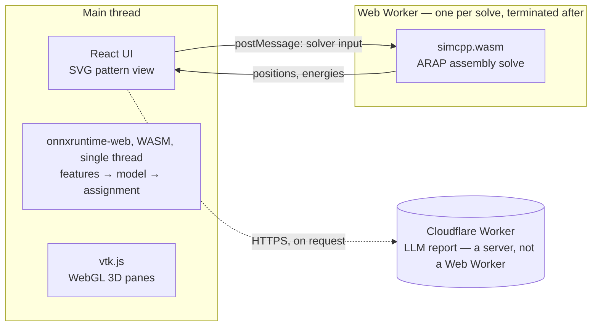

# AutoSew web demo

Drop a CLO DXF or a GarmentCodeData `*_specification.json` and the predicted stitching is
drawn over the flat pattern. Everything runs in the browser: the ONNX model is fetched
once and executed with onnxruntime-web (WASM), so no pattern leaves the machine. The one
exception is the LLM failure report, which sends the evaluation to a Cloudflare Worker
only when you press "generate a new report".

Live: <https://junseongahn.github.io/seam-correspondence/>

## Run and test

```bash
npm install
npm run dev        # http://localhost:5173
npm test           # Vitest, the pure logic and the parsers
npm run lint       # oxlint, including the import boundaries below
npm run build      # tsc -b (the typecheck), then the production bundle
npm run deploy     # build, then publish dist/ to GitHub Pages
```

## Threads

Checked in a browser, not assumed: no worker exists while the model predicts, and one
exists while the assembly is solved.



- **ONNX on the main thread.** Prediction took about 15–150 ms in our runs (the `ms` pill), so it is
  not worth a worker. GitHub Pages does not send the cross-origin isolation headers, so
  `crossOriginIsolated` is false and onnxruntime cannot start threads of its own either.
- **The solver in a worker.** `core-algorithm/sim/sim.worker.ts` is started by
  `solveInWorker` with `new Worker(new URL(...))` and is never imported, so it is not in
  any `index.ts`.

## Folders

```
src/
  core-algorithm/     logic more than one feature uses, or that wraps an outside runtime
    pattern/          DXF and specification readers, curves, the Pattern type
    inference/        features, the ONNX session, the stitch assignment
    sim/              the wasm solver and its worker
  features/
    input/            the drop zone, the examples
    stitch-view/      the 2D pattern: colours, focus, zoom and pan
    annotation/       drawing, saving and loading a ground truth by hand
    evaluation/       the score, the evaluation file, the LLM report
    preview3d/        the 3D pane beside the pattern
  styles/             tokens.css (variables, body defaults), shared.module.css
  useWorkspace.ts     the state the features share
  App.tsx             assembly and layout only
```

- Dependencies point one way: a feature's `ui/` uses its own `logic/` and
  `core-algorithm`; `logic/` uses `core-algorithm`; `core-algorithm` uses neither.
  Features never import each other.
- `logic/` and `core-algorithm/` are plain TypeScript: no React. That is what lets them be
  tested without a browser.
- State the features share (the pattern, the prediction, the ground truth, the
  hand-drawn pairs) lives in `useWorkspace` and reaches the features as props.
- Every boundary has an `index.ts` with named exports only (no `export *`):
  `core-algorithm/<module>/`, `features/<feature>/`, `features/<feature>/logic/`.
  Imports go through those and the `@/` alias; `npm run lint` rejects deep imports, a
  feature importing another, and React in `logic/` or `core-algorithm/`.
- Styles: `styles/tokens.css` is imported once, in `main.tsx`. Each component's styles are
  a `*.module.css` beside it; classes several features use are in
  `styles/shared.module.css`; `App.module.css` holds the page frame and layout.

## Design decisions

**Why SVG.** A pattern is tens to about a hundred edges, and clicking an edge is the main
interaction: focus a correspondence, or sew two edges by hand. SVG gives every edge its
own element with hit testing and events for free, and zooming is a change of `viewBox`
rather than redrawing, so there is no canvas picking code to write or keep right.

**Why no Redux.** All the shared state belongs to one screen, and every piece of it is
read by components that the same `App` renders. One hook owning it and passing props
keeps the data flow visible in the JSX; a store would add a layer of indirection with
no distant consumer to serve.

**Why the solver is in a worker.** It did not start there: the first version solved on
the main thread and froze the page for about ten seconds per garment. When the
exactly-predicted held-out garments were added, their solves measured 25.8 s and
109.4 s, long enough to raise the browser's "page unresponsive" dialog, so the solve
moved into a Web Worker and the page stays responsive throughout.

## What it does

1. `core-algorithm/pattern/parseSpec.ts` — port of `autosew/gcd_parser.py`. Panel-local
   coordinates (bbox lower-left at the origin), curvature typed to `k_t`, and the ACW
   canonicalisation that reverses clockwise panels. `parseDxf.ts` reads a CLO DXF into
   the same `Pattern`.
2. `core-algorithm/inference/features.ts` — port of `autosew/features.py`. 26 numbers per
   edge (24, with the curvature block as sagitta samples, plus arc length and
   arc/chord) and the prev/next cycle graph inside each panel.
3. `core-algorithm/inference/infer.ts` — runs `public/model/autosew.onnx`, then the hard
   assignment that cannot live in the graph: `P' = (P + P^T)/2`, per-row argmax, plus
   every entry over `tau = 0.4`.
4. `features/stitch-view/` — lays the panels out by their spec transform (back panels
   shifted right) and draws the overlay: green correct, red false positive,
   black dashed false negative.

A specification carries its own ground truth, so the counts shown for one are real, not
an estimate. A DXF carries none: the CLO example ships one drawn by hand in this page, and
any other DXF can have one drawn the same way.

## Keeping the port honest

The features must match the Python pipeline exactly or the prediction silently
degrades. Checked on four garments (54 to 122 edges, straight / circular /
quadratic / cubic edges, reversed and non-reversed panels):

| | result |
|---|---|
| node order, cycle neighbours, GT pairs | identical |
| 24-dim features | `max|diff| = 0.000e+00` |
| predicted pair set (vs PyTorch) | identical |

If `gcd_parser.py` or `features.py` change, re-check before trusting this demo.

## The model

`public/model/autosew.onnx` (7.1 MB, opset 17) is exported from the best
checkpoint of the 24k-garment run (`runs/r1`, epoch 5). On the official GCD
test split it scores TF1 0.917 and gets 1143 of 2072 garments exactly right;
the earlier 2.8k-garment model scored TF1 0.879. It takes `x (B,M,24)`, `nbr (B,M,2)`, `mask (B,M)`
and returns `logP (B,M+1,M+1)`; `B` and `M` are dynamic. No custom operators.

Two things had to be avoided at export time for onnxruntime to run it: `torch.eye`
with a bool dtype becomes `EyeLike`, which onnxruntime has no kernel for, and the
in-place slice assignments building `Cbar` become `ScatterND`. Both are replaced
with `arange` comparison and `concat` in the export script.
